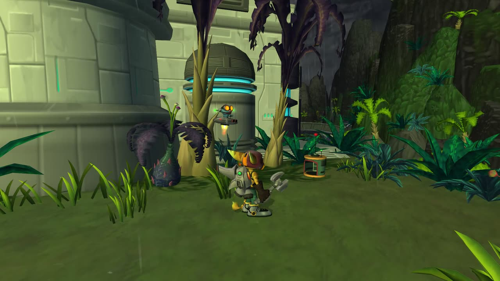
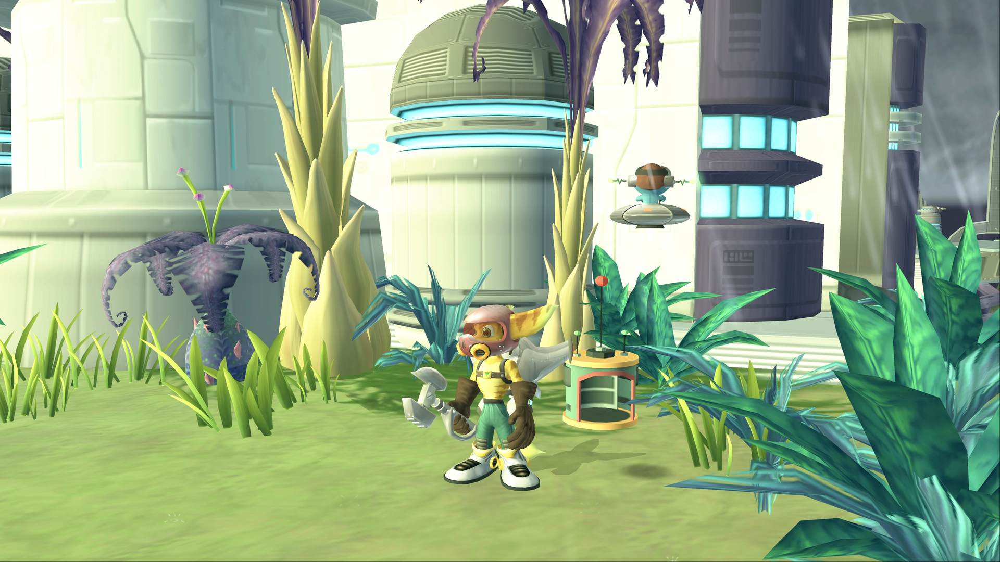

# Auto Head Gear

The Sonic Summoner and the O2 Mask work as soon as you own them, like in the later games.

[Watch it on YouTube](https://youtu.be/rYhU7HuhehI) (20 s, with sound): the Sonic Summoner owned,
the O2 Mask worn, and a sand mouse still comes out to follow.

## What it does

No more trips to the Items menu to put one on. Once you own them, both items work as if worn:

- **Sonic Summoner:** the sand mice answer it without it on Ratchet's head.
- **O2 Mask:** it keeps out Blarg's toxic gas and the gas of Rilgar's extermination robots without
  it on Ratchet's head.

Ratchet's head stays as it is: whatever you put on yourself keeps showing, and the game still puts
the mask on by itself underwater and in vacuum, as it always did.

**Your headgear stays on.** Put on the Pilot's Helmet, the O2 Mask or the Sonic Summoner for the
looks, and it stays on after a death, a planet change or a load, like the Grindboots and
Magneboots. Take it off and it stays off. Where the game puts the O2 Mask on by itself (underwater,
Blarg Station, Orxon, Gemlik Base, Drek's Fleet), it still does, and your own choice comes back when
you leave. Each save file keeps its own choice.

## How to use it

Nothing to press. Get the items as usual and they just work. To keep a piece of headgear on, put
it on once in the Items menu.

## Settings

| Setting | Default | Choices | What it does |
|---|---|---|---|
| Sonic Summoner when owned | On | On, Off | The sand mice answer the Sonic Summoner without it on Ratchet's head. |
| O2 Mask when owned | On | On, Off | The O2 Mask keeps out Blarg's toxic gas and the gas of Rilgar's extermination robots without it on Ratchet's head. |
| Keep chosen headgear on | On | On, Off | The headgear you put on in the Items menu, or none, stays as you chose after a death, a planet change or a load, like the boots. The game still puts the O2 Mask on by itself where it must. |

## Requirements

- **OpenRAC 1.1.0 or later** (mod interface 1.20).
- **Ratchet & Clank**, PAL and NTSC-U.
- No other mods needed.

## Compatibility and known issues

No conflicts with other mods are declared. An item you no longer own is not put back on.

## Credits

By Henning Berge. Licence: MIT.

## Feedback

Found a bug or have an idea? Open an issue on
[GitHub](https://github.com/Promises/rac1-auto-head-gear/issues). Pull requests are welcome.

Developer documentation: [README](README.md)
